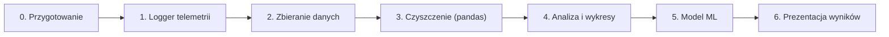

# Plan projektu: wirtualny inżynier wyścigowy (Assetto Corsa, Monza)

**Cel:** zebrać własną telemetrię z AC, oczyścić ją w pandas, przeanalizować i wytrenować model ML, który pokaże, gdzie tracisz czas na okrążeniu.

**Harmonogram:** około 5–6 tygodni przy kilku godzinach tygodniowo, czyli koniec mniej więcej w połowie grudnia. Zostaje zapas na pracę pisemną.

> [!IMPORTANT]
> Każdy etap kończy się **punktem kontrolnym**, czyli konkretną rzeczą, która ma działać. Nie przechodź dalej, dopóki go nie spełnisz. Każdy etap sam w sobie to coś, co można pokazać prowadzącemu.

---

## Etap 0: przygotowanie (1 wieczór)

**Do zrobienia:**
- Zainstaluj Content Manager. Ustal stałą konfigurację: **jedno auto GT3**, Ferrari 488 gt3 **Monza**, defaultowe ustawienia tyre blanckets check intermediate ideal conditions
- Utwórz środowisko Pythona (`venv`), repozytorium git i strukturę folderów, np. `src/`, `data/raw/`, `data/processed/`, `notebooks/`.
- Biblioteki na później: `pandas`, `numpy`, `matplotlib`, `scikit-learn`, `jupyter`.

**Punkt kontrolny:** repo z pierwszym commitem, działający `venv`, jedno przejechane okrążenie w wybranej konfiguracji.

---

## Etap 1: logger telemetrii (najtrudniejszy technicznie, ok. 1 tydzień)

**Cel:** skrypt w Pythonie, który podczas jazdy czyta dane z gry i zapisuje je do pliku CSV.

**Czego musisz się nauczyć / doczytać:**
- Czym jest **shared memory** w Windows i jak AC jej używa. Są trzy bloki: `acpmf_physics`, `acpmf_graphics`, `acpmf_static`.
- Moduły Pythona: `mmap` (otwarcie pamięci) i `ctypes` (`ctypes.Structure`, `_fields_`, `_pack_`), żeby zamienić surowe bajty na pola.
- Oficjalny opis struktur: na forum Kunos szukaj **„Shared Memory Reference”**. Zobaczysz tam kolejność i typy pól, i to musisz odwzorować.

**Jakie pola zapisywać (minimum):**
- z *physics*: `gas`, `brake`, `steerAngle`, `speedKmh`, `gear`, `rpms`, `accG`, `numberOfTyresOut`
- z *graphics*: `normalizedCarPosition` (pozycja 0–1 na torze, **najważniejsze pole**), `completedLaps`, `iCurrentTime`, `iLastTime`, `status`, `isInPit`

**Pytania do przemyślenia (rozwiąż je sam):**
- Jak często czytać dane? Wskazówka: `packetId` mówi, czy przyszły nowe dane.
- Jak nie zapisywać danych, gdy gra jest w menu albo na pauzie? Wskazówka: pole `status`.
- Jeden plik na sesję czy jeden na okrążenie?

**Kolejność pracy (małe kroki):**
1. Odczytaj i wypisz w konsoli **jedno** pole, np. `speedKmh`. Sprawdź, czy się zmienia, kiedy jedziesz.
2. Dodaj resztę pól.
3. Dodaj pętlę ze stałą częstotliwością.
4. Dodaj zapis do CSV (moduł `csv` albo zbieranie do listy i zapis na końcu).

**Punkt kontrolny:** po jednym okrążeniu masz CSV, w którym prędkość rośnie i spada w sensowny sposób, a `normalizedCarPosition` idzie od 0 do 1.

---

## Etap 2: zbieranie danych (2–3 sesje jazdy)

**Do zrobienia:**
- Przejedź **30–50 okrążeń**. Część jedź szybko, część spokojnie, a parę z celowymi błędami (późne hamowanie, wyjazd na pobocze). Zróżnicowane dane = lepszy model.
- Zapisuj w notatkach, które sesje były „specjalne”.

**Punkt kontrolny:** folder `data/raw/` z plikami CSV z kilku sesji.

---

## Etap 3: czyszczenie w pandas (ok. 1 tydzień)

**Cel:** jeden porządny DataFrame, w którym każdy wiersz ma przypisany numer okrążenia, a złe okrążenia są odrzucone.

**Zadania (to jest najważniejsza część nauki pandas):**
1. Wczytaj wszystkie CSV do jednego DataFrame'a (`pd.read_csv`, `pd.concat`, `glob`).
2. Podziel dane na okrążenia (`completedLaps` albo skok `normalizedCarPosition` z ok. 1 do ok. 0).
3. Odrzuć: okrążenie wyjazdowe, niedokończone, z pitów, z kołami poza torem (`numberOfTyresOut`).
4. Policz czas każdego okrążenia (`groupby`) i sprawdź, czy zgadza się z tym, co pokazywała gra.
5. **Kluczowy krok:** sprowadź okrążenia do wspólnej osi, czyli pozycji na torze, nie czasu. Np. podziel tor na 1000 odcinków i dla każdego okrążenia policz średnią prędkość, gaz i hamulec w każdym odcinku. Szukaj: `pd.cut`, `groupby`, `np.interp`.

**Punkt kontrolny:** tabela „okrążenie × odcinek toru” plus tabela z czasem każdego okrążenia. Zapisz wynik do `data/processed/`.

---

## Etap 4: analiza i wykresy (kilka dni)

**Pytania, na które masz odpowiedzieć wykresami:**
- Jak wygląda prędkość w funkcji pozycji na torze? Na wykresie powinieneś rozpoznać zakręty Monzy.
- Czym różni się najszybsze okrążenie od najwolniejszego? Gdzie hamujesz wcześniej, gdzie później dajesz gaz?
- **Delta czasu:** w którym miejscu toru tracisz najwięcej względem najlepszego okrążenia?
- Jaki jest rozkład czasów okrążeń (histogram)?

**Punkt kontrolny:** notebook z 4–6 wykresami i krótkimi wnioskami pod każdym.

> [!TIP]
> Zaznacz na wykresach nazwy zakrętów (Rettifilo, Curva Grande, Roggia, Lesmo 1/2, Ascari, Parabolica). Dużo zyskuje to przy prezentacji.

---

## Etap 5: model ML (ok. 1–1,5 tygodnia)

**Zadanie główne (regresja): przewidzieć czas okrążenia na podstawie tego, jak przejechałeś zakręty.**

1. **Feature engineering**, czyli zamiana okrążenia na kilka liczb. Przykłady: prędkość minimalna w każdym zakręcie, prędkość na wyjściu, punkt rozpoczęcia hamowania, procent czasu na pełnym gazie.
2. **Podział danych:** train/test. Przy małej liczbie okrążeń użyj **cross-validation** (`cross_val_score`).
3. **Modele do porównania** (od najprostszego):
   - `LinearRegression` jako punkt odniesienia
   - `RandomForestRegressor`
   - `GradientBoostingRegressor`
4. **Ewaluacja:** MAE, R². Który model jest najlepszy i dlaczego?
5. **Interpretacja:** `feature_importances_`, czyli które zakręty najbardziej wpływają na czas okrążenia. **To jest główny wniosek projektu.**

**Zadanie dodatkowe (jeśli zostanie czas), wybierz jedno:**
- Klasyfikacja „dobre / złe przejechanie zakrętu”.
- Model przewidujący, ile gazu i hamulca dać w danym punkcie toru (behavioral cloning, tylko offline, bez sterowania grą).

> [!WARNING]
> Mało danych (30–50 okrążeń) oznacza ryzyko przeuczenia (overfittingu). Jeśli Random Forest ma idealny wynik na treningu i słaby na teście, to nie jest błąd w kodzie, tylko wniosek do opisania w pracy.

**Punkt kontrolny:** tabela porównania modeli i wykres ważności cech.

---

## Etap 6: prezentacja wyników (kilka dni)

- Uporządkuj kod: logger w `src/`, analiza w notebookach, `README.md` z instrukcją uruchomienia.
- Opcjonalnie prosty dashboard w **Streamlit**: wybierasz okrążenie i widzisz porównanie z najlepszym.
- Ten materiał to od razu szkielet pracy pisemnej: cel, dane, metody, wyniki, wnioski.

---

## Gdzie co uruchamiać (lokalnie a Google Colab)

| Etap | Gdzie | Dlaczego |
|---|---|---|
| 1–2 (logger, jazda) | **Lokalnie na Windowsie** | Shared memory istnieje tylko na komputerze, na którym działa gra |
| 3–5 (pandas, wykresy, ML) | **Colab** (albo lokalnie) | Notebooki, gotowe biblioteki, łatwe udostępnianie prowadzącemu |
| 6 (Streamlit) | Lokalnie | Colab nie nadaje się do hostowania aplikacji |

**Przepływ danych:** logger zapisuje CSV do folderu z Google Drive na dysku (Google Drive for desktop), a w Colabie montujesz Drive (`drive.mount`) i czytasz pliki.

> [!NOTE]
> GPU i większa moc z AI Pro nie będą tu potrzebne. Twoje dane to kilka MB, a scikit-learn liczy na CPU. Zaleta Colaba to wygoda, nie moc.

## Proponowany harmonogram

| Tydzień | Etapy |
|---|---|
| 1 (od 4.11) | Etap 0 + początek etapu 1 |
| 2 | Etap 1 skończony + etap 2 (jazda) |
| 3 | Etap 3 (pandas) |
| 4 | Etap 4 (wykresy) |
| 5 | Etap 5 (ML) |
| 6 | Etap 6 + bufor |

## Źródła do nauki

- pandas: oficjalny „10 minutes to pandas” i rozdział o `groupby`
- scikit-learn: tutoriale „Getting Started” i „Cross-validation”
- Kaggle Learn: kursy „Pandas” i „Intro to Machine Learning” (krótkie, darmowe, idealne na start)
- AC Shared Memory Reference (forum Assetto Corsa / Kunos)
